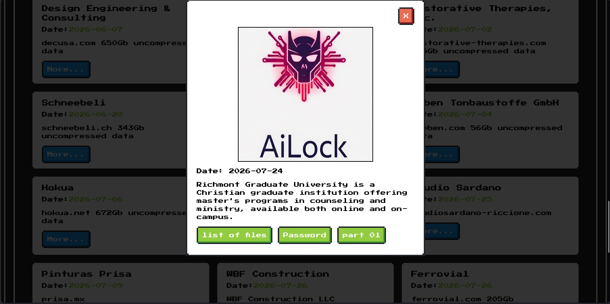
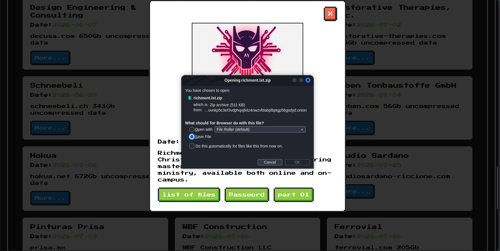

# AiLock Ransomware Threat Intelligence Investigation

## 1. Overview

This project documents a passive threat intelligence investigation into an AiLock-branded ransomware leak site.

During the investigation, Richmont Graduate University was observed in the site's victim listings.

## 2. Investigation Objectives

- Analyze publicly visible ransomware leak-site information.
- Document alleged victim listings and archive metadata.
- Correlate observations with public threat intelligence.
- Assess the reliability of ransomware claims.

## 3. Observations

| Attribute | Details |
|---|---|
| Threat Actor | AiLock |
| Alleged Victim | Richmont Graduate University |
| Listing Date | July 24, 2026 |
| Archive | richmont.lst.zip |
| Advertised Size | 511 KB |
| Archive Downloaded | No |

The site advertised a ZIP archive described as a file listing. The archive was not downloaded or accessed.

## 4. Evidence

### Evidence 1 — Victim Listing

### Evidence 2 — Advertised Archive

## 5. Threat Intelligence Assessment

The existence of the listing was directly observed.

However, the alleged breach, data exfiltration, and archive contents remain unverified.

Threat actor claims should not be treated as confirmed incidents without independent corroboration.

## 6. Conclusion

This investigation demonstrates passive threat intelligence collection, evidence documentation, and ransomware claim assessment.

No unauthorized access, exploitation, or leaked data downloading was performed.

This project is intended for educational and defensive cybersecurity research.
